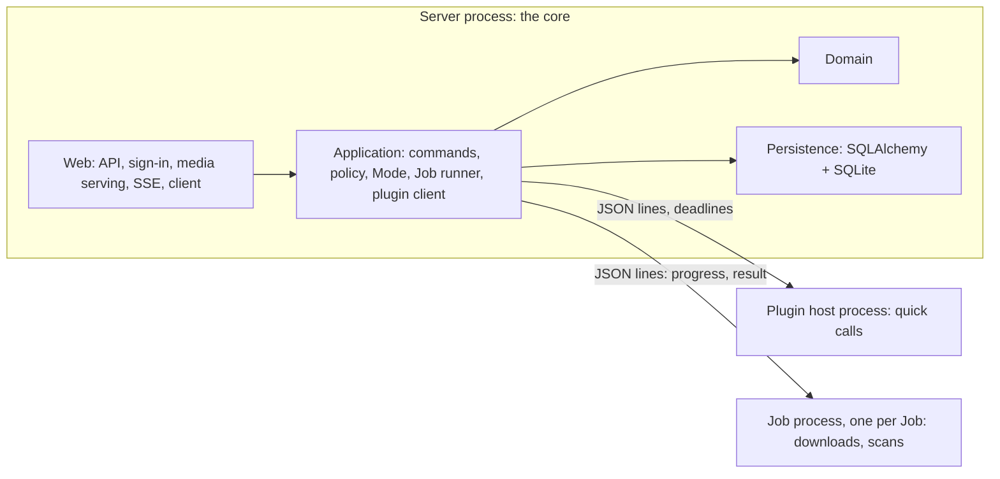

# Architecture

> [!IMPORTANT]
> **Status: approved; the core's Accounts, catalog, plugin host, Jobs, Libraries, and audio serving are implemented.** This note describes how medleyplay is
> built: a small core that is reviewed closely, and features that arrive as
> plugins behind feature toggles. What the MVP delivers, and in what order, is in
> [MVP](MVP.md).

## Contents

- [Goal](#goal) and [threat model](#threat-model)
- [Options](#options) and [processes](#processes)
- [Core and plugins](#core-and-plugins), [failures](#failures),
  [Jobs](#jobs), and [feature toggles](#feature-toggles)
- [Policy](#policy), [Accounts](#accounts), [linked accounts](#linked-accounts),
  and [Online and Offline](#online-and-offline)
- [Idempotent operations](#idempotent-operations),
  [quality gates](#quality-gates), and [what is left out](#deliberately-left-out)

## Goal

- Stay correct while features are added quickly. Plugins are written fast and
  not reviewed line by line, so the core must survive a plugin's bugs.
- Run on one machine for one household: SQLite and no external services.
- Make a new music site or storage kind a new plugin, not a core change.

## Threat model

- **Defended against: buggy plugins.** A plugin that raises, returns malformed
  data, hangs, leaks memory, or crashes never takes the server down or corrupts
  the core's data.
- **Not defended against: malicious plugins.** Plugins run as the same OS user
  as the core. Plugins are built in, written by us, and merged through CI; there
  is no third-party plugin loading.

## Requirements

| Kind | Requirement |
| --- | --- |
| Functional | Accounts with linked site logins; Libraries and Bilibili as Sources; per-device playback; Download policy per Account; Online and Offline modes |
| Scale | A household: a few Accounts, under ten devices at once, tens of thousands of Tracks |
| Availability | Survives the plugin failures above; boots even when a plugin can't load; recovers from a restart mid-Job |
| Change | Plugins change often; the core and the plugin API change rarely and on purpose |
| Constraints | One maintainer; Python 3.14, FastAPI, SQLite; mypy strict; macOS first |

## Options

| Option | Isolation | Cost | Verdict |
| --- | --- | --- | --- |
| In-process plugins, ports and adapters | Exceptions only; a hang or a crash takes the server with it | Lowest | Too weak for unreviewed code |
| **One plugin-host process, plus one process per Job** | Hang, crash, and memory; the core runs no plugin code | One small protocol | **Chosen** |
| A process per plugin over RPC | The same, per plugin | Process management per plugin | No gain over the chosen option for one household |

## Processes

- **The server process** runs only the core. It is the only writer to the
  database and the only process that serves media.
- **The plugin host** loads every enabled plugin and answers quick calls, such as
  recognizing a link or reading a link's details. Each call has a deadline. A
  call past its deadline kills the host, the core starts a new one, and the call
  fails.
- **A Job process** runs one long call, such as a download or a scan. It starts in
  its own process group, so cancelling a Job kills it and anything it spawned.
  It streams progress and then a result.
- **The protocol** is JSON lines over pipes. Every message is a Pydantic model
  from the plugin API, validated on both sides.
- **Plugins never touch the database or the data folder.** A call carries
  everything it needs: settings, the plugin's stored state, a working folder,
  and, for a Job that needs one, a temporary copy of a linked login. A plugin's
  state changes come back in its result, and the core applies them.
- **Media never flows through the protocol.** A plugin tells the core where the
  bytes are: a local path, or a path with an offset and length for a stored zip
  member. A compressed zip member, or a network drive later, is copied into the
  cache by a Job first. The core serves every file itself, with Range.

## Core and plugins

**The core** (reviewed closely):

- The domain: Account, Track, Source, Library, Playlist, smart-playlist rules,
  the policy and its removal orders, the Mode.
- The application: idempotent commands, the Job runner, and the plugin client.
- Persistence: SQLAlchemy and Alembic; only the core owns the schema.
- Web: the API, sign-in, media serving with Range, and SSE.
- Network detection for the Mode.

**The plugin API** (`medleyplay.plugin_api`): the Protocols, the message and value
models, a constant `API_VERSION`, and a contract test kit per extension point.
It is the only part of medleyplay a plugin may import; import-linter enforces it,
and the core never imports a plugin.

**The registry** is our own, typed one. Each plugin exposes
`register(registry)` and adds providers by key, for example
`registry.add(SOURCE_RESOLVER, "bilibili", resolver)`, so mypy checks a plugin's
shape where it registers. How plugins load and are called is in
[Plugin host](Plugin%20host.md). Every call goes through one guarded path: deadline,
circuit breaker, and validation. pluggy was considered and not chosen: it is
built for many plugins on one hook, while every extension point here has one
provider per key. Its results are untyped, and isolation would have to wrap each
implementation.

**Plugins** (`medleyplay.plugins.*`), built in:

| Extension point | Chosen by | Runs in | Responsibility | MVP plugin |
| --- | --- | --- | --- | --- |
| `SourceResolver` | Source kind | Host | Recognize a link, canonicalize it, and read its details | `bilibili` |
| `SourceDownloader` | Source kind | Job | Download a Source's audio into the working folder | `bilibili` |
| `CredentialSpec` | Source kind | Host | Describe the login a site needs, and check one | `bilibili` |
| `LibraryBackend` | Storage protocol | Job, host | List a Library; locate a file's bytes | `fsspec-library` (folder, zip) |
| `TagReader` | File type | Job | Read tags and artwork; flag protected files | `tinytag-tags` |

Plugins implement core-defined extension points only. They add no HTTP routes, no
tables, and no scheduled tasks; a new kind of feature starts as a new extension
point in the core.

### The bilibili plugin

The plugin implements the three Bilibili extension points through one facade,
backed by two tools that read Bilibili differently. The core sees one resolver,
one downloader, and one credential spec, never the tools.

| Backend | Role | How it reads Bilibili | Runs as |
| --- | --- | --- | --- |
| yt-dlp | Default | The video page, plus APIs | A library inside the Job process |
| yutto | Fallback | Bilibili's web APIs | A separate command started by the Job process |

- **Fallback rule:** when yt-dlp fails with a *plugin* failure, such as an
  extractor that no longer understands the page, the Job retries once with
  yutto. Network and auth failures don't fall back, since yutto would hit the
  same wall. The Download records which backend produced it, and site health in
  Settings shows each backend separately.
- **Plugin settings** choose the order, or turn the fallback off.
- **Each backend returns the plugin API's models,** so the contract tests run
  against both. For example, a resolve returns the same Source key and parts
  whichever backend answered.
- **Bundled tools.** The plugin declares yt-dlp and yutto as its own
  dependencies, so installing the plugin installs both.
  - **yutto is GPL-3.0**, so medleyplay never imports it. The plugin only runs
    it as a separate program and ships its license notice with the
    third-party notices.
  - **yutto needs ffmpeg** even for audio only. Without ffmpeg, the fallback
    is off and Settings says why.
- **Linked accounts:** yt-dlp reads the Job's temporary cookies file. yutto
  receives the session as an auth file (`--auth-file`) in the Job's working
  folder, never on its command line, where other processes could read it.

## Failures

- **Three classes.** A *network* failure (unreachable, timeout) parks the Job
  until the Mode is Online again and doesn't count as an attempt. An *auth*
  failure (login expired) marks the linked account *needs sign-in*. A *plugin*
  failure (an exception, malformed output, a deadline) counts toward the
  circuit breaker.
- **Circuit breaker.** After repeated plugin failures, the plugin is *faulted*
  and skipped, and stays faulted across restarts until an admin resets it.
- **Retries** back off. A Source that keeps failing for a reason that won't
  change, such as a removed video, becomes *unavailable* and is no longer
  retried by the policy.
- **Site health** shows in Settings, from the outcomes of real Jobs.

## Jobs

| State | Meaning |
| --- | --- |
| `waiting` | Held until the Mode is Online |
| `queued` | Ready to start |
| `running` | Has a process, which holds its Job's lock |
| `succeeded`, `failed`, `cancelled` | Finished |

- **One active Job per kind and target**, enforced by a partial unique index.
  Asking again returns the existing Job.
- **Startup recovery:** kill the process group of each `running` Job whose
  process still holds its lock, set them back to `queued`, and reconcile the
  download folder against `download` rows: remove stray temporary files, and
  record or remove files with no row. How Jobs run is in [Jobs](Jobs.md).
- **Completing a Download:** validate the result, rename the file into place, and
  record the row in one step that the reconcile can always finish.
- **Online to Offline:** running Download Jobs are cancelled and go back to
  `waiting`; their partial files are removed.

## Feature toggles

- **One source of truth:** the config file, which also holds core settings such
  as `multiple_accounts`. Settings edits it, and the change applies on restart,
  which Settings offers.
- **A disabled plugin is never imported.**
- **Safe start.** A plugin that fails to import, targets another `API_VERSION`,
  or claims a key already taken is *quarantined*, and the server boots without
  it. `medleyplay serve --safe-mode` starts with every plugin off.
- **Data outlives its plugin.** Tracks whose Source kind has no enabled plugin
  stay in the catalog. Their existing Downloads play, and the policy treats them
  as unsatisfiable rather than failed.

## Policy

- **All in the core**, including every removal order, because removal deletes
  the household's files.
- **A pure `plan(state) -> actions`.** The state includes running, waiting, and
  failed Jobs, so a failing download is not requested again on every run.
  `plan(apply(plan(s)))` is a no-op, which a Hypothesis property checks.
- **Invariants**, each a Hypothesis property:
  - a wanted Download is never removed;
  - when the wanted set exceeds the limit, medleyplay reports it rather than
    removing wanted Downloads;
  - a Download downloaded, served, or wanted in the last day, or one that
    can't be downloaded again, is never removed.
- **Across Accounts:** the wanted set is the union of every Account's *Keep
  downloaded* playlists, computed at each evaluation; see
  [Download policy](Download%20policy.md#the-wanted-set). A single limit is set by
  an admin, and Settings shows the space each Account's rules hold.
- **Which login downloads:** the Account that asked, or for a policy Download,
  the first Account that wants the Track and has a valid linked account.

## Accounts

- **One Account by default.** The core setting `multiple_accounts`, off by
  default, lets an admin create more Accounts. Off, the household signs in with
  the first Account. The data model is the same either way, so turning it on
  later needs no migration; turning it off stops new Accounts and leaves existing
  ones working. Tests cover both values.
- An **Account** is a person in the household, with a username, a password
  (Argon2id), and a role: **admin** or **member**. The first Account is the admin;
  afterward, an admin creates Accounts. The last admin can't be removed or
  demoted, and `medleyplay reset-password` recovers a lost admin password.
- **Signing in** creates a server-side session behind an HttpOnly, SameSite=Lax
  cookie; with the Host and Origin checks, this covers cross-site requests.
  Repeated failed sign-ins are throttled. Signing out ends the session at once,
  and *Sign out everywhere* ends them all.
- **Shared by the household:** Libraries, Tracks, Sources, Downloads, Jobs, the
  storage limit, and the Mode. The *Downloads* tab shows who asked for each.
- **Each Account's own:** favorites, ratings, play history, playlists, smart
  playlists, the default audio quality, and *linked accounts*.
- **Deleting an Account** removes its sessions, playlists, and so its wants, and
  linked accounts.
- **Built from pwdlib and our own session table.** pwdlib hashes passwords with
  Argon2id and rehashes them on sign-in when its parameters change. Sessions
  store only a SHA-256 hash of a random token and expire after inactivity. Creating
  the first admin happens in one transaction, so two simultaneous first
  registrations can't both become admin. fastapi-users was considered and not
  chosen:
  - it is in maintenance mode;
  - it forces an async database and email sign-in;
  - it stores session tokens in the clear;
  - it would still need our own account creation and *Sign out everywhere*.

## Linked accounts

- A *linked account* is an Account's login on a site, such as Bilibili cookies.
  It is a credential for the whole site account.
- **Stored in the macOS Keychain** through `keyring`, never in the database; the
  data folder holds one only while a Job uses it.
- **Used per Job:** the core writes a temporary owner-only copy into the Job's
  working folder and deletes it after the Job. The copy is read-only: an
  expired login is pasted again. How is in [Bilibili](Bilibili.md#linked-accounts).
- **States:** *valid*, *needs sign-in*. Logs redact it.

## Online and Offline

- The **Mode** is *Online*, *Offline*, or *Auto* (the default), server-wide.
- **Auto** is Online when the server is on Wi-Fi or a wired network **and** sites
  are reachable. Reachability comes from real calls' outcomes plus an occasional
  light check, and the Mode changes only after it has been stable for a short
  time. Wi-Fi networks you mark as *metered*, such as a phone hotspot, count as
  Offline.
- **Online:** requested Downloads start at once.
- **Offline:** medleyplay contacts no music site.
  - Downloads wait in the *Downloads* tab.
  - A pasted link is saved raw; it is canonicalized, and merged with any
    existing Source, once Online.
  - A Track whose audio isn't downloaded shows *available when online*. In the
    MVP, adding a Bilibili Track downloads it, so this happens only after the
    policy removed its Download.
- **Libraries are unaffected** by the Mode.

## Idempotent operations

- **Natural keys:** a canonical Source that already exists returns its Track;
  alias links (short links, `av` and `BV` ids, part numbers) canonicalize to one
  key.
- **Client-chosen ids for new things:** `PUT /playlists/{id}` with a client UUID.
  An id that belongs to another Account is refused.
- **Absolute values, not toggles:** `PUT` a rating or a favorite.
- **Jobs:** one active per target; retry-safe through temporary files and
  reconcile.
- **The policy:** `plan` is idempotent, as above.

## Quality gates

- **Core and plugin API:** reviewed line by line (CODEOWNERS); 90% line and 85%
  branch coverage; Hypothesis properties for the domain and the policy.
- **Plugins:** merge when CI is green. Each passes its extension point's contract
  tests (for example: a result validates, and calling twice leaves the same
  observable state) and a lower coverage floor. Logic is tested against recorded
  fixtures, never live sites.
- **Architecture:** import-linter contracts in CI.

## Deliberately left out

- **Third-party plugins** from installed packages: they would run with the same
  rights as the core.
- **An event bus:** no extension point needs one yet. Progress reaches clients
  from the core over SSE.
- **Plugin routes, tables, and UI:** see Core and plugins.
- **HTTPS on the LAN:** sessions travel in the clear on the home network. A
  reverse proxy with a local certificate can be added later.
- **Per-Account storage quotas.**
