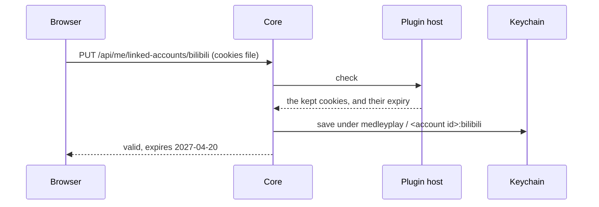
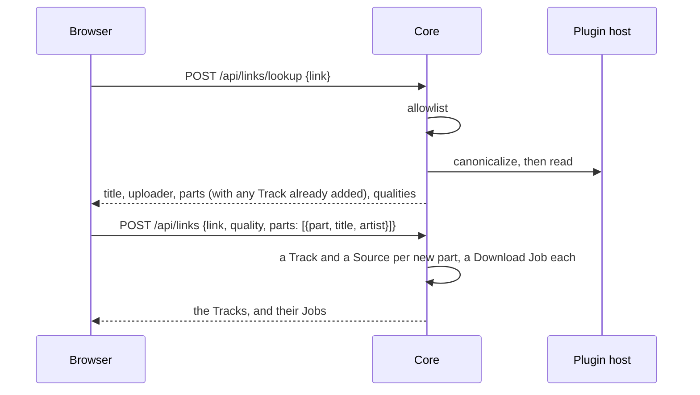

# Bilibili

> [!NOTE]
> **Status: proposed.** This note describes how medleyplay adds music from
> Bilibili: linking an Account's login, turning a link into Tracks, downloading
> their audio, playing the Downloads, and reporting progress to every browser.
> What adding must do is in [MVP](MVP.md#add-from-bilibili); why the plugin has
> two backends is in [Architecture](Architecture.md#the-bilibili-plugin).

## Contents

- [Where this stands](#where-this-stands)
- [Extension points](#extension-points)
- [Linked accounts](#linked-accounts)
- [Links](#links)
- [Adding from a link](#adding-from-a-link)
- [Downloads](#downloads)
- [Playing a Download](#playing-a-download)
- [Progress over SSE](#progress-over-sse)
- [The bilibili plugin](#the-bilibili-plugin)
- [What the API shows](#what-the-api-shows)
- [Testing](#testing)
- [Left for later steps](#left-for-later-steps)

## Where this stands

yt-dlp can't read any Bilibili video today: its extractor fails with *Unable to
extract initial state* on every video tried, in the latest release and the
nightly build, and the fix is still under review upstream. yutto signs in but
can't read the sample video either. So step 5 is built in two parts:

- **Step 5a** builds everything up to the tools: the extension points, linked
  accounts, links, adding, Downloads, playing them, SSE progress, and the yt-dlp
  backend, written against yt-dlp's documented info fields and tested against a
  fixture made from them.
- **Step 5b**, once yt-dlp is fixed, raises the pinned version, records a real
  video's info as the fixture in place of the made one, checks a real download
  by hand, and adds the yutto fallback.

This overrides the MVP's step 0, which had the Bilibili steps wait for the fix:
everything but the tools can be built and tested without Bilibili. Until 5b,
the plugin is **off by default**, since every lookup would fail; turning it on
with `[plugins.bilibili] enabled = true` shows the failure as it is. 5b ends with
a check that the recorded fixture and the made one agree, or the made one goes.

## Extension points

Each is keyed by Source kind, `bilibili`.

| Point | Operation | Runs in | Deadline | Does |
| --- | --- | --- | --- | --- |
| `SOURCE_RESOLVER` | `canonicalize` | Host | 5 s | Turns a link into a video id and an optional part, following a short link |
| | `read` | Host | 10 s | Reads a video's title, uploader, parts, and audio qualities, without a login |
| `SOURCE_DOWNLOADER` | `download` | Job | 2 h | Downloads one part's audio into the Job's working folder, with a login if given |
| `CREDENTIAL_SPEC` | `check` | Host | 5 s | Reads a pasted cookies file and keeps only the cookies the site needs, with their expiry |

- **The core owns the link allowlist,** not the plugin: see [Links](#links).
- **Locators are checked by the plugin API:** a video id is letters, digits,
  `_`, and `-`, and a part is a number from 1, so a plugin can't hand the core a
  path or a URL as a key.
- **An ordinary *no* is a reply, not a failure,** as a Library's missing file
  is: `canonicalize` answers *not a video* for a link to a channel or a live
  room, `read` answers *gone* or *needs a login* for a removed or members-only
  video, and `download` answers *gone*. Only a plugin that breaks counts toward
  its circuit breaker.
- **Qualities are Bilibili's own audio ids,** so either backend fills them:
  `30216` (64 kbps), `30232` (132 kbps), and `30280` (192 kbps), all AAC. Dolby
  (`30250`, E-AC-3) and Hi-Res (`30251`, FLAC) are left out of the MVP, since
  not every household browser plays them. *Best* means the best of those three
  that the login allows.
- **`read` has no login,** since logins reach only Jobs. So a members-only video
  can't be added yet; the lookup says why.
- **The plugin host answers one call at a time,** so a lookup holds up other
  calls, such as locating a Library file, for up to its deadline. The core runs
  one lookup at a time and keeps each video's details for ten minutes, so the
  add that follows a lookup, or a lookup repeated, asks Bilibili nothing. Playing
  a file already played locates nothing, so the cost is a first play during a
  lookup waiting a few seconds, which suits one household. yt-dlp's own socket
  timeout is set below the deadlines.
- **`download` reports progress** as bytes arrive, so the idle timeout catches a
  stalled download, and returns the file's name in the folder, the quality it
  got, and which backend made it.
- **`check` makes no network call.** It parses the file and returns only the
  cookies the plugin names, for its own domains, with the session cookie's
  expiry. Whether the login still works is learned from real Jobs.

## Linked accounts

A *linked account* is an Account's login on a site: for Bilibili, its cookies.

- **Pasting:** the body is at most 64 KB, since exporters write every site's
  cookies. The core sends it to `check` and keeps only what comes back; the
  pasted text is never stored or logged.
- **The login is kept in the macOS Keychain** through `keyring`, under the
  service `medleyplay` and the name `<account id>:<site>`. The database keeps
  only its state, expiry, revision, and when it was saved, in `linked_account`.
  The Keychain is written first and the row second, so a crash between them
  leaves a secret with no row, which the next save replaces.
- **Keychain calls are bounded:** macOS can prompt for access or be locked, so
  each call runs off the event loop and the runner's thread, with a 5-second
  limit. A call that fails or times out fails what asked, with a message saying
  the Keychain didn't answer.
- **States:** *valid*, and *needs sign-in* after a Job's `AuthError`, once the
  expiry passes, or when the Keychain no longer holds it. Saving a login again
  makes it valid and raises its revision.
- **Reaching a Job:** a Job kind that needs a login names its site, and its Job
  names whose login to use and the revision it saw. The runner writes the login
  into `login.txt` in the Job's working folder, readable by its owner alone, and
  passes the path to the program. The working folder is removed after the Job,
  and at startup. So a login lives in the data folder only for a Job's length.
- **A Job's copy is read-only and thrown away.** yt-dlp doesn't refresh a
  Bilibili session, so nothing comes back: an expired session is pasted again.
- **An `AuthError` marks the login *needs sign-in*** only when the plugin says
  the login was refused, not on an anti-bot refusal, and only when the login's
  revision is still the Job's, so a late failure can't mark a login pasted since.
  A Job without a login fails with *this video needs a Bilibili login*.
- **Removing** a linked account deletes the Keychain item and the row; a Job
  already running keeps its copy until it ends. Deleting an Account removes its
  logins.
- **The login never leaves the core:** no route returns it, nothing logs it, and
  a failure message that holds a cookie's value, as written or URL-decoded, has
  it replaced before it is stored.
- **Plain HTTP:** the pasted file crosses the LAN in the clear, as the session
  cookie does; see [Architecture](Architecture.md#deliberately-left-out).

## Links

- **The core recognizes a link** before any plugin sees it. It must be `http` or
  `https`, with no user, password, or port, at most 2 KB long, and its host must
  be in the allowlist, which maps each host to a Source kind:

  | Host | Kind |
  | --- | --- |
  | `bilibili.com`, `www.bilibili.com`, `m.bilibili.com` | `bilibili` |
  | `b23.tv` | `bilibili` |

  Anything else is refused with 422.
- **The plugin canonicalizes it:** `av` ids become `BV` ids, `?p=` becomes a part
  number, and a `b23.tv` short link is followed. The plugin rebuilds the first
  request as `https://b23.tv/<code>` from a code of letters and digits, never
  fetching the pasted text, and follows one redirect at a time, at most three,
  checking each hop against its own copy of the allowlist before fetching it,
  with no cookies, no proxy, and no body read. The plugin returns the link it
  ended on, and the core checks that link with its full rules again.
- **yt-dlp is handed a URL the plugin builds** from the `BV` id and the part,
  with only Bilibili's extractors allowed, so its generic extractor never runs.
- **A Source's locator is `<BV id>/p<part>`,** such as `BV1Xx41117Tz/p1`; a video
  with one part has `p1`. So every link to a part, short or long, `av` or `BV`,
  is one Source.

## Adding from a link

- **Looking up** answers the video's details, each part's Track if it is
  already in the catalog, and the qualities. It waits on host calls, never on a
  Job. A link that is not a video, or a video that is gone or needs a login,
  answers 422 with why.
- **The client suggests a title and an artist:** the part's title for a video
  with several parts, otherwise the video's, with bracketed tags such as
  `【MV】` at either end removed; the uploader is the artist. The household edits
  both before adding.
- **Adding** doesn't trust the client: it canonicalizes the link again, and
  checks each part and the quality against the video's details, from the
  lookup's ten-minute memory or a fresh `read`. At most 50 parts are added at
  once, and a title or an artist is 1 to 512 characters.
- **Each part is one transaction:** it creates a Track and a Source, or finds
  the existing Source by its natural key and keeps its Track. Two adds racing for
  one part meet at the Source's unique key; the loser rolls back and reads the
  winner's Track, so no Track is left without a Source.
- **Every part without a Download gets a Download Job,** with the adding
  Account's login when it has a valid one. A part already being downloaded keeps
  its Job, even one without a login. So adding twice adds nothing new, and
  returns the same Tracks and Jobs.
- **A part already in the catalog keeps its quality,** and an *unavailable* one
  starts no Job: adding returns it as it is. Choosing another quality is step 7.
- **No Mode yet:** the server counts as Online until step 6, so a link is always
  read at once.

## Downloads

A *Download* is the one copy of a Bilibili Source on the server's disk.

- **A Download Job** has the kind `download_source` and the target
  `source:<id>`, so one Source has at most one active download.
- **The program** calls `download` with the Source's locator, its quality, the
  working folder, and the login file, if any. It then checks the file the plugin
  named, or the Job fails as a plugin fault: a bare name directly in the folder,
  opened without following links, a regular file, not empty, at most 1 GiB, and
  with an extension of an AAC audio type (`m4a`). It fsyncs the file.
- **The completion** renames the file over `downloads/<source id>.<ext>` in the
  data folder and records it in `download` with the quality it got, its backend,
  size, and time, in the transaction that ends the Job. A Source has one file.
  After the commit, a file of the Source with another extension is removed.
- **A crash between the rename and the commit** leaves a file with no row. The
  Job runs again and its file replaces that one, and at startup the core removes
  every file in `downloads/` that no row names.
- **Failures** follow [Jobs](Jobs.md#failures-and-retries). The plugin sorts
  yt-dlp's errors by their types, not their text: a connection error, a
  timeout, a 429, or a 5xx is a `NetworkError`, which waits; a refused login is
  an `AuthError`; a video the site says is gone is the reply *gone*, which makes
  its Source *unavailable*; and anything else is a fault, which retries.
- **A 403 or a 412 is a fault,** since it is Bilibili refusing the request,
  usually to a client it suspects. So it is never retried every minute: it uses
  the Job's three attempts, and five in a row fault the plugin until an admin
  resets it.
- **Disk space** isn't reserved yet; a full disk fails the Job, and its working
  folder is removed. The storage limit is step 6.

## Playing a Download

- **A Bilibili Source with a Download** plays from its file, whatever the
  Source's state and whatever its plugin's health: a video removed since, or a
  plugin turned off or faulted, doesn't stop a Download playing. This changes
  [Playback](Playback.md), where a Source plays only when it is *ok*. The file
  goes through the same checks as a Library file: the core opens it without
  following links, requires a regular file inside `downloads/`, and serves it
  with Range.
- **One without a Download** answers *preparing* with its Download Job, using
  the caller's login when it is valid. A file that vanished is downloaded again.
  An *unavailable* Source without a Download is unplayable and starts no Job.
- **A Library Source still wins** over a Bilibili one that must be downloaded,
  as a ready Source wins over one being prepared.

## Progress over SSE

- **`GET /api/events`** streams Server-Sent Events, with FastAPI's own
  `EventSourceResponse`, to any signed-in browser. Each event is a `job` event
  holding the Job as `GET /api/jobs` shows it.
- **An event is sent** when a Job is submitted, changes state, or reports
  progress; progress is sent at most four times a second per Job.
- **No replay:** a browser that reconnects asks `GET /api/jobs` again, so events
  carry no ids. A comment every 15 seconds keeps the connection open.
- **A slow browser can't hold the server back:** each connection has a bounded
  queue. A progress event that doesn't fit is dropped, since the next one
  replaces it; a change of state that doesn't fit closes the connection, so that
  browser reconnects and asks again.
- **A stream ends with its session:** the comment every 15 seconds checks the
  session first, so signing out ends the stream.
- **One stream per page.** Over plain HTTP a browser opens about six connections
  per server, so a page holds one stream; sharing it between tabs is step 7.
- **The runner and the services publish after their commit,** from any thread,
  to a hub on the server's event loop.

## The bilibili plugin

- **One module holds every call to yt-dlp,** which has no type hints, and returns
  typed values, as the fsspec plugin does for fsspec.
- **yt-dlp runs as a library** with a quiet logger, no playlist expansion, no
  post-processing, and `bestaudio` limited by the chosen quality. Bilibili's
  audio is an `m4a` stream, so no ffmpeg is needed.
- **The yt-dlp module is thin and marked unverified** until 5b: it maps yt-dlp's
  info into the plugin API's models, and nothing else knows yt-dlp's shape.
- **Its failures are sorted** by yt-dlp's error types as in
  [Downloads](#downloads). An error yt-dlp marks *expected*, such as a removed or
  region-locked video, is an answer; the extractor failure seen today is not
  expected, so it is a fault.
- **The format** is the best audio-only AAC stream at or below the chosen
  quality; a video without one, such as an old one with only a muxed stream, is
  *gone* for the MVP, with the codec in the message.
- **`av` to `BV`** is the site's published conversion, tested on known pairs.
- **The kept cookies** are `SESSDATA`, the session, and `buvid3`, the device id,
  for `.bilibili.com`; the list is the plugin's data, checked again in 5b.
  `bili_jct`, which authorizes changes to the site account, is dropped, so a
  leaked copy can't change the account. `SESSDATA` alone is still a full
  session: it can read anything the account can.

## What the API shows

| Route | Who | Does |
| --- | --- | --- |
| `GET /api/me/linked-accounts` | Signed in | The caller's linked accounts: site, state, expiry, when saved |
| `PUT /api/me/linked-accounts/{site}` | Signed in | Saves a login from a cookies file; 422 when it holds no session |
| `DELETE /api/me/linked-accounts/{site}` | Signed in | Removes the login; 204, also when there is none |
| `POST /api/links/lookup` | Signed in | A link's video: title, uploader, parts with any existing Track, qualities |
| `POST /api/links` | Signed in | Adds the chosen parts as Tracks and starts their Downloads |
| `GET /api/events` | Signed in | Job events over SSE |
| `POST /api/tracks/{id}/playback` | Signed in | Now also plays a Download, or answers *preparing* with its Job |

## Testing

- **The core, with a fake plugin:** the allowlist, canonicalizing, looking up,
  adding twice, a part already in the catalog, Download completions, playing a
  Download, and a plugin that returns a host outside the allowlist, a locator
  that isn't one, or a file outside its folder.
- **Linked accounts** against an in-memory stand-in for the Keychain: saving,
  replacing, removing, a Keychain that doesn't answer, a login copy in a real
  Job process that is owner-only and gone afterwards, an `AuthError` marking the
  login *needs sign-in*, and a late one leaving a newer login valid. One test,
  skipped off macOS, saves to and removes from the real Keychain.
- **Downloads:** a file the plugin names outside its folder, behind a link,
  empty, or of another type fails the Job; a crash between the rename and the
  commit is swept at startup; a Download still plays when its Source is
  unavailable or its plugin is off.
- **SSE:** a submitted, progressing, and finished Job each reach a subscriber;
  a full queue closes its connection.
- **The plugin:** canonicalizing every link shape, `av` to `BV` on known pairs,
  short links against a stub server, cookies files with and without a session,
  and the yt-dlp module against a fixture of yt-dlp's documented info fields,
  with its failures sorted. The contract kits run against it.
- **Never live:** no test contacts Bilibili; a live check is an opt-in marker
  run by hand, in step 5b.

## Left for later steps

- **Step 5b:** the fixed yt-dlp, a recorded fixture, a live check, and the yutto
  fallback with ffmpeg.
- **Step 6:** the Mode, Offline links, the storage limit, and removing Downloads.
- **Step 7:** the add dialog, linked accounts in Settings, and changing a
  Source's quality.
