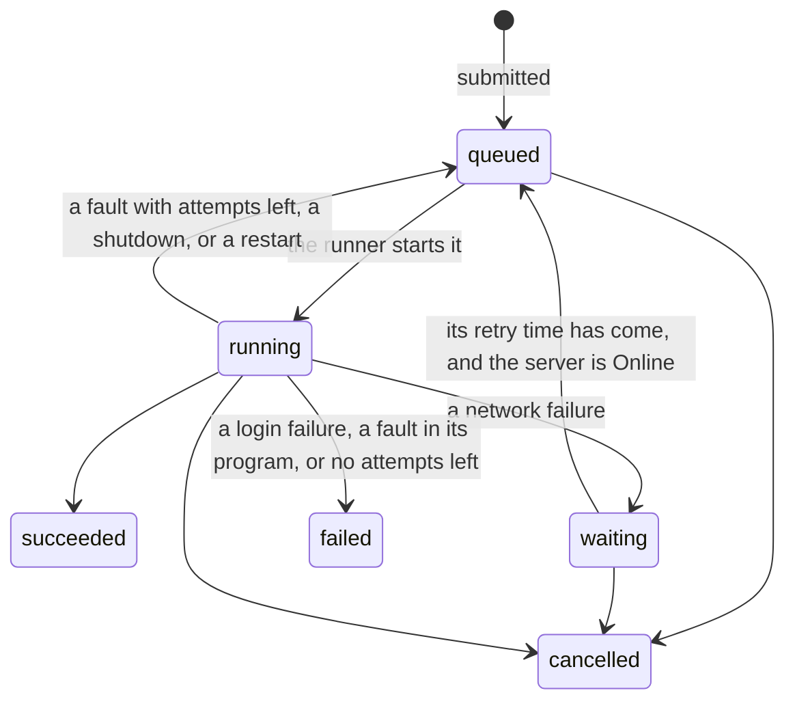

# Jobs

> [!NOTE]
> **Status: implemented.** This note describes how the core runs long work, such
> as a download or a Library scan, in a process of its own, and how a Job
> survives failures and restarts. Why Jobs run outside the server is in
> [Architecture](Architecture.md#processes); how plugins load is in
> [Plugin host](Plugin%20host.md). The first Job kind scans a
> [Library](Libraries.md).

## Contents

- [A Job's life](#a-jobs-life)
- [Job kinds and programs](#job-kinds-and-programs)
- [The runner](#the-runner)
- [Failures and retries](#failures-and-retries)
- [Recovery after a restart](#recovery-after-a-restart)
- [What the API shows](#what-the-api-shows)
- [Testing](#testing)

## A Job's life



- **One active Job per kind and target.** A partial unique index on the `job`
  table holds at most one *waiting*, *queued*, or *running* Job for a pair such
  as `scan_library` and `library:3`. Submitting again returns the active Job.
- **The database decides every change.** Each change of state is a
  compare-and-set: a running Job moves on only while its row still says
  *running*. So when a cancel and a completion arrive together, whichever commits
  first wins, and the other changes nothing.
- **A running Job has a process** in its own process group, a working folder
  `jobs/<id>` in the data folder, and progress the runner keeps in memory: a
  restart loses progress, never state.
- **Finished Jobs stay** in the table with their outcome.
- **The Mode doesn't exist yet,** so the server counts as Online; *waiting* holds
  only Jobs whose network failed, until their retry time.

## Job kinds and programs

A **Job kind** is core code with two halves:

| Half | Runs in | Does |
| --- | --- | --- |
| The **program** | The Job process | Calls plugins, reports progress, and returns a result model |
| The **completion** | The server | Applies the result to the database, in the transaction that marks the Job *succeeded* |

```python
ECHO = JobKind(
    name="echo",
    program="tests.support.programs:ECHO",
    request=EchoJob,
    result=Echoed,
    complete=record_echo,
    points=("echo",),
)
```

- **The program** is a `JobProgram` named by its module path. It receives its
  request, and a context that calls plugins in the Job process, reports
  progress, and holds the working folder. It writes nothing outside that
  folder; its result goes to `result.json` there, so a large result never has to
  fit in one message.
- **The completion** runs no plugin code, so a plugin can't corrupt the
  database: the worst it can do is fail its Job. A completion that moves files
  out of the working folder must tolerate finding them already moved, since a
  crash can fall between the move and the commit. A completion stays short, as
  it holds the database's one write lock.
- **A program may catch a plugin's failure** and carry on, as a scan does when
  one file's tags can't be read. A failure it doesn't catch fails the Job.

## The runner

- **The runner** is a thread in the server. It starts queued Jobs whose retry
  time has come, up to two at once, and supervises each from a thread that
  reads its process's messages.
- **The Job process** loads only the plugins that hold keys for its kind's
  `points`, leaving out faulted ones, then runs the program. Like the plugin
  host, it keeps standard input and output for the protocol, so a plugin that
  prints can't corrupt a message.
- **An idle Job is killed.** A Job process that reports nothing for its kind's
  idle timeout, ten minutes by default, is killed as a fault, so a program
  reports as it goes, for example as a download's bytes arrive. One that grows
  past 2 GiB is killed the same way.
- **The Job process ends with the server.** When the pipe from the server
  closes, the process kills its own process group, ending any program it
  started, such as a downloader.
- **Cancelling** marks the Job *cancelled* first, then kills a running Job's
  process group.
- **Shutting down** stops starting Jobs, ends the running ones, waits for their
  supervisors, and puts them back in the queue without counting an attempt.
- **One server per data folder.** A server holds a lock on `server.lock` in the
  data folder while it runs, so a second server can't recover the first one's
  Jobs. The data folder must be on a local disk, where file locks work.

## Failures and retries

| Failure | Next state | Counts as an attempt |
| --- | --- | --- |
| `NetworkError` | *waiting*, for a minute | No |
| `AuthError` | *failed* | — |
| A plugin's fault, an idle timeout, too much memory, or a crashed process | *queued* after a delay, or *failed* on the third attempt | Yes |
| A fault in the program or the completion | *failed* | — |

- **Retry delays** double from 30 seconds.
- **A Job's plugin calls count toward the plugin's circuit breaker** as calls in
  the plugin host do, key by key. The Job process reports, for each key it used,
  how many calls failed in a row at the end, and whether any call before them
  succeeded, so a fault the program caught still counts.
- **Attempts and faulting differ on purpose:** three attempts bound one Job,
  while five faults in a row bound a plugin across every Job and call.
- **Retry** submits a failed or cancelled Job again as a new Job, or returns the
  one already active for that target.

## Recovery after a restart

The server is the only runner, so a Job left *running* at startup belongs to a
server that stopped.

- **Each Job process holds a lock** on `jobs/<id>/lock`. The runner takes the
  lock before starting the process and hands it over, so the lock is held from
  the process's first instant until the process ends, when the operating system
  releases it. The lock tells the runner whether the process is still alive
  without trusting a process id that may have been reused.
- **At startup**, the runner kills the process group of each running Job whose
  lock is still held, puts each running Job back in the queue, and removes every
  working folder, including any login copies a Job had there.
- **A Job interrupted by three restarts fails**, so a Job that keeps bringing the
  server down can't loop forever.

## What the API shows

| Route | Who | Does |
| --- | --- | --- |
| `GET /api/jobs` | Signed in | The newest Jobs first, with state, progress, and outcome |
| `GET /api/jobs/{id}` | Signed in | One Job |
| `POST /api/jobs/{id}/cancel` | The Account that asked, or an admin | Cancels it; idempotent |
| `POST /api/jobs/{id}/retry` | The Account that asked, or an admin | Submits a failed or cancelled Job again |
| `GET /api/events` | Signed in | A `job` event each time a Job changes, over SSE; see [Bilibili](Bilibili.md#progress-over-sse) |

Jobs are shared by the household, so every Account sees them. Each Job kind adds
its own route to submit one, such as scanning a Library. A kind that needs a
site's login gets a copy of the submitting Account's; see
[Bilibili](Bilibili.md#linked-accounts).

## Testing

- **Real processes.** The runner is tested through real Job processes running a
  test program, *echo*, whose requests ask it to report progress, call the test
  plugin `parrot`, fail, crash, hang, or start a child process.
- **Recovery** is tested with stand-in Job processes: one that holds its Job's
  lock is killed, and one that doesn't, as a reused process id would be, is left
  alone.
- **A program's own logic** is tested in the test process, without a Job
  process.
