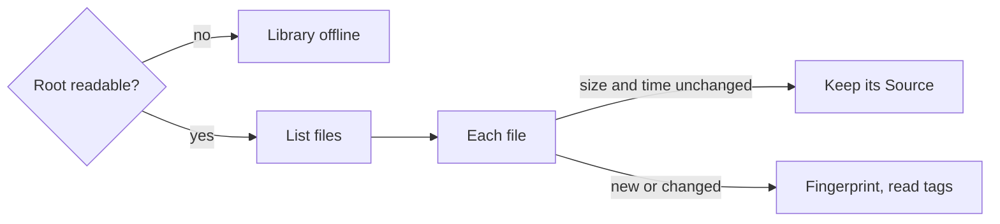

# Libraries

> [!NOTE]
> **Status: implemented.** This note describes how medleyplay reads your own
> music: registering a Library, scanning it, and keeping its Tracks across
> rescans. What a scan must do is in [MVP](MVP.md#scan-a-library); how plugins
> and Jobs run is in [Plugin host](Plugin%20host.md) and [Jobs](Jobs.md).

## Contents

- [Extension points](#extension-points)
- [Plugins](#plugins)
- [Registering a Library](#registering-a-library)
- [Scanning](#scanning)
- [What the API shows](#what-the-api-shows)
- [Testing](#testing)

## Extension points

| Point | Key | Operation | Runs in | Does |
| --- | --- | --- | --- | --- |
| `LIBRARY_BACKEND` | Storage kind: `folder`, `zip` | `check` | Host | Says whether a root can be read |
| | | `list_files` | Job | Lists every file under a root, with size and modification time |
| | | `locate` | Job, host | Says where a file's bytes are: a path, an offset, and a length |
| | | `fingerprint` | Job | Returns the file's size plus a hash of its first and last 64 KB |
| | | `fetch` | Job | Copies a compressed zip member into a given folder |
| `TAG_READER` | File extension: `mp3`, `flac`, … | `read_tags` | Job | Reads a file's tags and duration, and says whether it is protected |

- **A root** is a storage kind and a path, such as `zip` and `~/Music/Old.zip`.
  A file in it is a path relative to the root, with `/` between folders.
- **A location** is where the core finds a file's bytes: a local path, with an
  offset and a length for a member stored uncompressed in a zip archive. A
  compressed member has no location of its own; it is fetched first. A file that
  isn't there, or an archive that can't be read now, is *missing*: an ordinary
  answer, so an unplugged drive can't fault the plugin. A location can go stale
  when an archive changes, so the core asks again whenever the file it points
  into has changed; see [Playback](Playback.md#serving-audio).
- **Paths can't leave their root.** The plugin API refuses a file path that is
  absolute or holds `..`, both in a request and in a listing, and the backends
  check that a resolved path stays inside its root. The core checks every
  location again before it serves a byte, and a fetched copy must land in the
  folder the program gave, which the program checks.
- **No operation writes to a Library.**

## Plugins

| Plugin | Provides | Built on |
| --- | --- | --- |
| `fsspec-library` | `folder` and `zip` backends | fsspec |
| `tinytag-tags` | A tag reader for each extension tinytag reads, and `m4p` | tinytag |

- **fsspec has no type hints,** so one module of the plugin holds every call to
  it and returns typed values.
- **Symbolic links are left out** of a folder's listing, so a link can't lead
  outside the root or into a loop. Encrypted zip members, and members named
  outside the archive's tree, are left out too.
- **A zip member's modification time is the archive's own,** since zip times are
  coarse: changing the archive rescans every member.
- **A protected `.m4p` file** is read by the plugin's own reader with
  `protected` set, so its Track is listed as *can't play*.
- **A file tinytag can't parse has no tags,** rather than failing the call, so a
  folder of damaged files can't fault the plugin; its Track is named after the
  file.

## Registering a Library

- **An admin registers a Library** with a name, a storage kind, and a path. The
  core expands `~` and resolves the path, refuses one inside its own data folder,
  and asks the backend to `check` the root, so a typo is refused at once.
- **Registering the same root again** returns the existing Library, ignoring the
  new name: a root is a Library's natural key.
- **Registering starts a scan.**
- **Removing a Library** cancels its scan, and removes its Sources, and any Track
  left without a Source; playlists drop those Tracks. Library ids are never
  reused, so a late scan of a removed Library changes nothing.

## Scanning

A scan is a Job of the kind `scan_library`, with the target `library:<id>`.

- **The program** checks the root and asks the backend for the files with an
  extension some tag reader handles. It skips each file whose size and
  modification time match the last scan, unless the scan is *full*, or the last
  scan couldn't read the file's tags. For a new or changed file it takes the fingerprint and reads
  the tags, fetching a compressed zip member into the working folder first. A
  file whose tags can't be read is recorded with the error, and the scan goes
  on.
- **The completion** applies the scan in one transaction:
  - a new path whose fingerprint matches exactly one Source of the same Library
    that the scan didn't see, and no other new path, is a move: that Source
    follows it, keeping its Track and every Account's ratings and history. An
    ambiguous match, such as two copies of one file, is no move;
  - any other new path becomes a Track and a Source;
  - a changed file updates its Track's details from its tags;
  - a Source the scan didn't see becomes *missing*, and a missing Source that is
    seen again is *ok*;
  - a protected file's Source is *can't play*.
- **An unreadable root, or a root that held files and now lists none,** marks the
  Library *offline* and marks nothing missing, so an unplugged drive costs no
  history. A listing that fails part way fails the scan, which then retries.
- **A file is recognized after a move by its fingerprint,** which covers its
  tags, so a file both moved and retagged between two scans becomes a new Track.
- **The program's request carries what the last scan recorded,** and the
  completion runs in one transaction; both grow with the Library, which suits a
  household's tens of thousands of files.
- **A Source's locator is `<library id>/<path>`,** with the path exactly as the
  backend listed it, so the same file in two Libraries is two Sources.

## What the API shows

| Route | Who | Does |
| --- | --- | --- |
| `POST /api/libraries` | Admin | Registers a Library and starts its scan; 201, or 200 for a root already registered |
| `GET /api/libraries` | Signed in | Every Library, with its state, file count, and last scan |
| `POST /api/libraries/{id}/scan` | Admin | Starts a scan, or returns the one running; `?full=true` reads every file again |
| `DELETE /api/libraries/{id}` | Admin | Removes a Library; 204, also when it is already gone |

## Testing

- **Fixture audio is made by the tests:** small WAV files with tags, in folders
  and zip archives, stored and compressed.
- **The contract kits** for both points run against both plugins.
- **The scan** is tested end to end through a real Job process, and its
  completion against scans that add, change, move, and lose files, and that find
  the root unreadable or empty.
