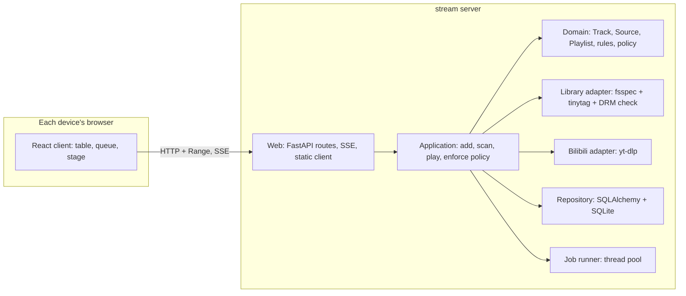

# MVP

> [!NOTE]
> **Status: proposed.** This note describes the first usable version of stream
> and is awaiting review. Names in *italics* are proposed terms still open for
> review.

## Goal

- Play your music from any device on the home network, in its own browser,
  from **local libraries** and from **Bilibili**.
- One household on a trusted network: no accounts, no internet exposure.
- Unintrusive: stream never moves, renames, or retags your files. What it knows
  about your music lives in its own data folder.

## Decisions at a glance

| Area | Decision | Why |
| --- | --- | --- |
| Playback | Each device plays in its own browser; the server stores and serves audio | Simplest; a phone keeps its own queue |
| Server | Python 3.14, FastAPI, SQLAlchemy 2 + Alembic on SQLite (WAL) | Native HTTP Range for Safari seeking; autogenerated migrations |
| Client | React + Vite + TypeScript | The most mature ecosystem |
| Layout | The song table and queue for browsing; a stage view for Now playing | Fits 16:9 Bilibili covers, messy titles, and keyboard use; leaves room for MVs |
| Bilibili | yt-dlp as a library, behind an interface; your own login cookies | The only maintained, permissively licensed option; no headless browser |
| Libraries | fsspec behind a `Library` interface; folders and zip archives now | Network drives later by configuration, without new code paths |
| Tags | tinytag (MIT); a small reader of our own for protected `.m4p` files | mutagen is GPL; tinytag reports no DRM |
| Audio quality | Best available audio by default; a lower tier on request | Your choice; a song is a few MB |
| Video | Off by default; per song, download the MV too, and Now playing shows it | Needs ffmpeg; offered only when ffmpeg is installed |
| Bilibili playback | Adding a Bilibili Track downloads it; a Track without a Download plays once a new Job finishes | A request never waits on a Job |
| Download policy | *Smart playlists* marked *Keep downloaded*, a *storage limit*, and a *removal order* | Rules you write, not a fixed cache |
| Over the limit | Rules win: kept songs are never removed to make room; stream warns | A song you asked to keep stays |
| Removal order | *Least favorite*: see [Enforce the policy](#enforce-the-policy) | The one order the MVP needs; others plug in |
| Background work | A small thread pool in the server process, Jobs in SQLite, progress over Server-Sent Events | No broker or worker process for one household |
| Data folder | One folder for the database, Downloads, and cache: `STREAM_DATA_DIR`, defaulting to the platform's app-data folder | One thing to back up; your Libraries stay untouched |
| Toolchain | mypy strict, pytest, Hypothesis, ruff; ESLint, Vitest, Playwright | Fully typed; see the instructions files |

## Language

| Term | Meaning |
| --- | --- |
| **Track** | A piece of music: title, artists, album, duration, artwork. It has a **favorite** flag, an optional **rating** of 1–5 stars, and one play history shared by every device. |
| **Source** | Where a Track's audio comes from: a file in a Library, or a Bilibili video part. A Source can be **missing** (gone at the last scan) or **unavailable** (removed from Bilibili). |
| **Library** | A storage root you register: a folder or a zip archive now, a network drive later. stream only reads it. |
| *Download* | The one copy of a Bilibili Source on the server's disk, at an **audio quality**, optionally with the video. |
| **Playlist** | An ordered list of Tracks. A *smart playlist* is defined by **rules** instead of a list. |
| *Keep downloaded* | A switch on a smart playlist: every Track it matches should have a Download. |
| *Storage limit* | The most disk space Downloads and the cache may use. |
| *Removal order* | Which Download goes first when the limit is reached. |
| **Queue** | What plays next on one device. It lives in that device's browser. |
| **Job** | Background work with progress and a result: a Download or a Library scan. |

## Architecture

- **Ports and adapters.** The domain imports nothing from the web, yt-dlp,
  fsspec, or SQLAlchemy; an import-linter contract enforces it.
- **The domain sees time and disk space through ports** (`Clock`, `DiskSpace`),
  so policy and recency rules are tested without a real clock or a full disk.
- **Package layout:** `src/stream/{domain,application,adapters,web}`, and the
  client in `web/`.

## Data model

- `track`: title, artist, album, album artist, duration, favorite, rating, play
  count, last played, added.
- `source`: track, kind (`library` or `bilibili`), a unique locator per kind (a
  path in a Library, or a BV id and part), a quick fingerprint (size plus a hash
  of the first and last 64 KB), state (`ok`, `missing`, `unavailable`, `can't
  play`), and kind-specific details as JSON.
- `library`: name, fsspec URL and options, the last completed scan.
- `download`: source (unique), file path, audio quality, has video, size,
  created, last served.
- `playlist` and `playlist_entry`; a smart playlist stores its rules and the
  *Keep downloaded* switch.
- `job`: kind, source or Library, state, progress, error.
- Settings: storage limit, removal order, default audio quality, where the
  Bilibili cookies file is.
- **Smart-playlist rules are a typed, versioned schema** (Pydantic), stored as
  JSON with a version number. Rules match on favorite, rating, play count, last
  played, added, artist, album, and Source kind.
- **Kind-specific details are typed too:** each Source kind owns a Pydantic
  model for its JSON, so nothing reads untyped dictionaries.
- A new kind of Source, such as Netease or YouTube, is a new `kind` and an
  adapter; the schema doesn't change.

## Flows

### Add from Bilibili

- Paste a link. stream accepts only `bilibili.com` and `b23.tv` addresses,
  resolves short links, checks the host again, and hands yt-dlp only the
  canonical video URL with its Bilibili extractor.
- stream reads the title, uploader, parts, and available qualities. You edit the
  cleaned title and artist, pick the quality, and optionally keep the video.
- Each part you choose becomes a Track, and a Download Job starts for it.
  Progress streams to every open browser.
- A long mix or live recording stays one Track; splitting by chapter is not in
  the MVP.

### Scan a Library

- A scan is a Job. It first checks that the root is reachable. A previously
  populated Library that now lists no files is marked **offline**, and nothing
  is marked missing.
- Walk the Library through fsspec, skip files whose size and modification time
  are unchanged, read tags with tinytag, and mark protected `.m4p` files as
  *can't play*. Nothing is written to the Library.
- **Identity across rescans:** a file at a known path keeps its Source. A new
  path whose fingerprint matches a missing Source is a move; the Source follows
  it, and the Track keeps its rating, history, and playlists.
- Only a completed scan marks unseen Sources **missing**. A missing Source
  returns when its file reappears. Nothing is deleted.
- The MVP doesn't merge duplicate Tracks, such as the same song in a folder and
  on Bilibili.

### Play

- The browser asks for a Source's audio by its id; the server never takes a
  path from the client.
- A Library file streams through fsspec with Range support. A stored
  (uncompressed) zip member is read in place; a compressed member is extracted
  once into the cache, and that copy is served.
- A Download is served from disk.
- A Bilibili Track without a Download (removed by the policy) answers
  *preparing* with a Job id. The client shows the Track as preparing and plays
  it when the Job finishes. No request waits on a Job.

### Enforce the policy

- **A pure function, `plan(state) -> actions`**, decides what to download and
  what to remove; the application carries the actions out. Running `plan` on its
  own result changes nothing.
- **One evaluation at a time.** A Download finishing, or a change to a favorite,
  rating, playlist, rule, or the limit, requests an evaluation. Requests that
  arrive while one runs merge into the next.
- **Steps:**
  1. The wanted set is every Track matched by a *Keep downloaded* smart
     playlist.
  2. Download wanted Tracks that are missing a Download, while the limit allows.
     A running Job reserves its estimated size.
  3. Over the limit, remove cache copies, then Downloads outside the wanted set,
     in removal order, until usage is back under the limit.
  4. If the wanted set alone exceeds the limit, start no more Downloads and show
     a warning in Settings until it is resolved.
- **Never removed:** a wanted Download, a Download served in the last hour (it
  may be playing on some device), and a Download with a running Job.
- **Least favorite order:** Tracks that aren't favorites before favorites;
  unrated before 1 star, then up to 5 stars; then least recently played (never
  played first); then oldest added.
- **What the limit counts:** Downloads, cache copies, and running Jobs'
  reservations. The database is not counted.

## Errors and boundary cases

- **Bilibili fails** (the extractor broke, the login expired, a request was
  refused): the Job fails with the reason and the Track stays; *Retry* reruns
  it. Settings shows the yt-dlp version in use.
- **A video is removed or region-locked after it was added:** its Source is
  *unavailable*; an existing Download still plays.
- **A quality needs a premium login you don't have:** fall back to the best
  available and record the quality actually downloaded. Choosing another quality
  later replaces the Download.
- **Video needs ffmpeg:** the option is hidden when ffmpeg is not installed.
  stream prefers H.264 and AAC so Safari can play the result.
- **Protected `.m4p`:** listed as *can't play* and never served.
- **A Library goes offline** (a drive is unplugged): it is marked offline and its
  Tracks are greyed out, not deleted.
- **Interrupted work:** a Download writes to a temporary name and is renamed into
  place when complete; only then is its `download` row created. At startup,
  running Jobs become failed (retryable) and stray temporary files are removed.
- **Duplicate requests:** one running Download Job per Source; a second request
  joins the first.
- **Disk full during a Download:** the Job fails and its temporary file is
  removed.
- **SQLite under threads:** each connection sets a busy timeout, foreign keys,
  and WAL; transactions stay short.

## Security

The MVP trusts the home network but not every page a browser on it opens.

- **Host and Origin checks** reject requests whose `Host` or `Origin` isn't the
  server's own, which blocks cross-site requests and DNS rebinding.
- **Libraries:** only local folders and zip archives in the MVP (an fsspec
  protocol allowlist). Locators are checked to stay inside their Library; `..`
  and absolute member paths are rejected.
- **Bilibili only:** the link allowlist above; yt-dlp never receives an
  arbitrary URL.
- **The cookies file** is a credential for your Bilibili account: owner-only
  permissions, never served, never logged.
- **Binding:** listens on all interfaces by default, since LAN devices must
  reach it; the address is configurable.

## Testing

- **Domain:** unit tests plus Hypothesis properties, for example: after
  enforcement, usage fits the limit unless the wanted set alone exceeds it; a
  wanted Download is never removed; `plan` on its own result is a no-op; rules
  round-trip through JSON.
- **Adapters:** fsspec's in-memory filesystem and zip fixtures (stored and
  compressed members) for Libraries. For yt-dlp, a recorded info JSON from a
  real video and a local HTTP server. Tests never contact Bilibili; a live check
  is an opt-in marker you run by hand.
- **Web API:** httpx tests for Range: `bytes=0-1`, open-ended, suffix
  (`bytes=-N`), unsatisfiable (416), multiple ranges (answered with the first),
  `HEAD`, `ETag` with `If-Range`, and `audio/mp4` for `.m4a`.
- **Client:** Vitest for components and Playwright for playback, seeking, and the
  queue.
- **iOS by hand:** a short checklist per release for the lock screen,
  background playback, and moving to the next Track while locked, which
  Playwright's WebKit can't reproduce.
- **Coverage floors:** 90% line and 85% branch.

## Client notes

- **One persistent `<audio>` element**; the next Track swaps its `src`, so
  autoplay keeps working on iOS after the first tap.
- **Queue advance follows the `ended` event**, never a timer.
- **Media Session:** metadata, actions, `playbackState`, and
  `setPositionState`.
- **The queue is saved in IndexedDB**, best effort; the browser may clear it.

## MVP checklist

- [ ] Add a folder or zip Library, scan it, and flag protected files.
- [ ] Add from Bilibili by link: parts, quality, optional video, editable title
      and artist.
- [ ] Play, pause, seek, next, and previous; a per-device queue; lock-screen
      controls through the Media Session API.
- [ ] Favorite and rating; playlists; smart playlists with *Keep downloaded*.
- [ ] Storage limit with *least favorite* removal; a warning when kept songs
      exceed it.
- [ ] Job progress in every open browser, and *Retry* for failed Jobs.
- [ ] Bilibili login from a cookies file or the browser, with its status shown.
- [ ] Settings: Libraries, Bilibili account, storage, and the yt-dlp version.
- [ ] `stream backup <file>`: a consistent copy of the database through SQLite's
      backup API; the database is the only copy of ratings and playlists.

**Not in the MVP:** searching Bilibili, importing Bilibili favorites, network
drives, other removal orders, merging duplicate Tracks, splitting a video by
chapter, playback on the server itself, a terminal client, other music sites,
lyrics, and sign-in.

## Build order

Each step is one branch, designed briefly, built test-first, and merged before
the next. From step 3 on, each step is usable in a browser.

0. **Bilibili check:** confirm that the pinned yt-dlp downloads the sample
   video's audio with your cookies, and record its info JSON as a fixture. If
   it still fails, the Bilibili steps wait for an upstream fix while the rest
   proceeds.
1. **Catalog:** Tracks, Sources, and Playlists in SQLite, with migrations.
2. **Libraries:** the `Library` interface over fsspec, scanning, tags, and the
   DRM check.
3. **Playback:** serving audio with Range, and a bare page with the player,
   queue, and lock-screen controls.
4. **Bilibili:** the yt-dlp adapter, Jobs, and progress events.
5. **Download policy:** smart-playlist rules, the storage limit, and removal.
6. **Client views:** the song table, queue, stage, add dialog, and settings.
7. **Video:** MV downloads with ffmpeg, and video in the stage view.

## Open questions

1. **Names:** *Download* or *Local copy*; *Library* or *Folder* for storage
   roots; *Removal order*.
2. **Sign-in:** none, or a household passcode? Recommended: a passcode for
   Settings only (Libraries, the cookies file, the storage limit), while
   browsing and playback stay open.
3. **Video in the MVP:** keep it as step 7, or move it after the MVP? It brings
   ffmpeg and Safari codec limits.
