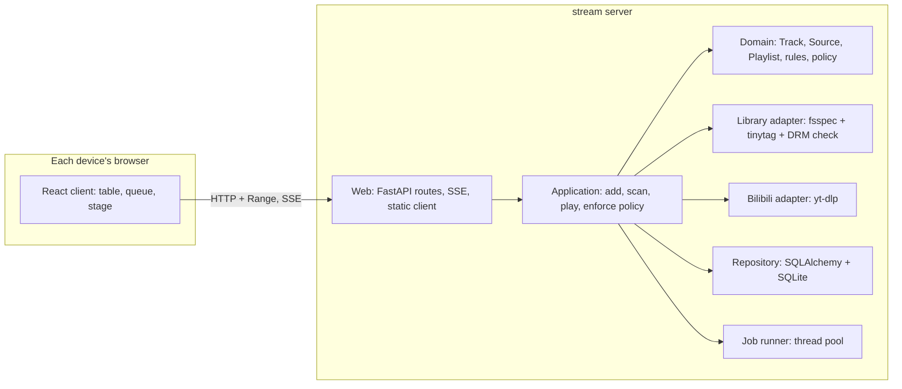

# MVP

> [!NOTE]
> **Status: proposed.** This note describes the first usable version of stream
> and is awaiting review. Names in *italics* are proposed terms still open for
> review.

## Goal

- Play your music from any device on the home network, in its own browser,
  from **local libraries** and from **Bilibili**.
- One household on a trusted network: no accounts, no internet exposure.
- Unintrusive: stream never moves, renames, or retags your files. What it knows
  about your music lives in its own database.

## Decisions at a glance

| Area | Decision | Why |
| --- | --- | --- |
| Playback | Each device plays in its own browser; the server stores and serves audio | Simplest; a phone keeps its own queue |
| Server | Python 3.14, FastAPI, SQLAlchemy 2 + Alembic on SQLite (WAL) | Native HTTP Range for Safari seeking; autogenerated migrations |
| Client | React + Vite + TypeScript | The most mature ecosystem |
| Layout | The song table and queue for browsing; a stage view for Now playing | Fits 16:9 Bilibili covers, messy titles, and keyboard use; leaves room for MVs |
| Bilibili | yt-dlp as a library, behind an interface; your own login cookies | The only maintained, permissively licensed option; no headless browser |
| Libraries | fsspec behind a `Library` interface; folders and zip archives now | Network drives later by configuration, without new code paths |
| Tags | tinytag (MIT); a small reader of our own for protected `.m4p` files | mutagen is GPL; tinytag reports no DRM |
| Audio quality | Best available audio by default; a lower tier on request | Your choice; a song is a few MB |
| Video | Off by default; per song, download the MV too, and Now playing shows it | Needs ffmpeg to merge video and audio |
| Download policy | *Smart playlists* marked *Keep downloaded*, a *storage limit*, and a *removal order* | Rules you write, not a fixed cache |
| Over the limit | Rules win: kept songs are never removed to make room; stream warns | A song you asked to keep stays |
| Removal order | *Least favorite*: lowest rating first, then least recently played | The one order the MVP needs; others plug in |
| Background work | A small thread pool in the server process, jobs in SQLite, progress over Server-Sent Events | No broker or worker process for one household |
| Toolchain | mypy strict, pytest, Hypothesis, ruff; ESLint, Vitest, Playwright | Fully typed; see the instructions files |

## Language

| Term | Meaning |
| --- | --- |
| **Track** | A piece of music: title, artists, album, duration, artwork. It has a **favorite** flag and an optional **rating** of 1–5 stars. |
| **Source** | Where a Track's audio comes from: a file in a Library, or a Bilibili video part. One Track can have several Sources. |
| **Library** | A storage root you register: a folder or a zip archive now, a network drive later. stream only reads it. |
| *Download* | A copy of a remote Source on the server's disk, at an **audio quality**, optionally with the video. |
| **Playlist** | An ordered list of Tracks. A *smart playlist* is defined by **rules** instead of a list. |
| *Keep downloaded* | A switch on a smart playlist: every Track it matches should have a Download. |
| *Storage limit* | The most disk space Downloads may use. |
| *Removal order* | Which Download goes first when the limit is reached. |
| **Queue** | What plays next on one device. It lives in that device's browser. |
| **Job** | A Download in progress, with progress and a result. |

## Architecture

- **Ports and adapters.** The domain imports nothing from the web, yt-dlp,
  fsspec, or SQLAlchemy; an import-linter contract enforces it.
- **Package layout:** `src/stream/{domain,application,adapters,web}`, and the
  client in `web/`.

## Data model

- `track`: title, artist, album, album artist, duration, favorite, rating, play
  count, last played, added.
- `source`: track, kind (`library` or `bilibili`), a unique locator per kind (a
  path in a Library, or a BV id and part), whether it can play, and
  kind-specific details as JSON.
- `library`: name, fsspec URL and options, last scan.
- `download`: source, file path, audio quality, has video, size, created.
- `playlist` and `playlist_entry`; a smart playlist stores its rules as JSON and
  the *Keep downloaded* switch.
- `job`: source, state, progress, error.
- Settings: storage limit, removal order, default audio quality, where the
  Bilibili cookies file is.
- A new kind of Source, such as Netease or YouTube, is a new `kind` and an
  adapter; the schema doesn't change.

## Flows

- **Add from Bilibili.** Paste a link, and stream reads the video's title,
  uploader, parts, and available qualities. You edit the cleaned title and
  artist, pick the quality, and optionally keep the video. Each part you choose
  becomes a Track. *Add and play* starts a Job, and its progress streams to
  every open browser.
- **Scan a Library.** Walk it through fsspec, skip files whose size and
  modification time are unchanged, read tags with tinytag, and mark protected
  `.m4p` files as unplayable. Nothing is written to the Library.
- **Play.** The browser requests a Track's audio. A Library file streams through
  fsspec with Range support; a Download is served from disk; a Bilibili Source
  without a Download is downloaded first and then served. That copy counts
  toward the limit and is removed before any kept Download.
- **Enforce the policy** after each Download and whenever a favorite, rating,
  playlist, or rule changes:
  1. The wanted set is every Track matched by a *Keep downloaded* smart
     playlist.
  2. Download wanted Tracks that are missing, while the limit allows.
  3. Over the limit, remove Downloads outside the wanted set in removal order.
  4. If the wanted set alone exceeds the limit, stop downloading and warn.

## Errors and boundary cases

- **Bilibili fails** (the extractor broke, the login expired, a request was
  refused): the Job fails with the reason and the Track stays. yt-dlp is pinned
  and Dependabot proposes updates weekly.
- **A quality needs a premium login you don't have:** fall back to the best
  available and record the quality actually downloaded.
- **Protected `.m4p`:** listed as *can't play* and never served.
- **A Library goes offline** (a drive is unplugged): it is marked offline and its
  Tracks are greyed out, not deleted.
- **Disk full during a Download:** the Job fails and its partial file is removed.
- **Seeking in a compressed zip member** decompresses from the start of the
  member; acceptable for songs, noted for large files.
- **Security:** the server only reads inside registered Libraries and its own
  download folder, only fetches Bilibili addresses, and never serves or logs the
  cookies file (owner-only permissions).

## Testing

- **Domain:** unit tests plus Hypothesis properties, for example: after
  enforcement, Downloads fit the limit unless the wanted set alone exceeds it,
  and a wanted Download is never removed.
- **Adapters:** fsspec's in-memory filesystem and zip fixtures for Libraries; a
  local HTTP server for the yt-dlp adapter. Tests never contact Bilibili; a live
  check is an opt-in marker that CI never runs.
- **Web API:** httpx tests, including Range responses.
- **Client:** Vitest for components and Playwright for playback, seeking, and the
  queue.
- **Coverage floors:** 90% line and 85% branch.

## MVP checklist

- [ ] Add a folder or zip Library, scan it, and flag protected files.
- [ ] Add from Bilibili by link: parts, quality, optional video, editable title
      and artist.
- [ ] Play, pause, seek, next, and previous; a per-device queue; lock-screen
      controls through the Media Session API.
- [ ] Favorite and rating; playlists; smart playlists with *Keep downloaded*.
- [ ] Storage limit with *least favorite* removal; a warning when kept songs
      exceed it.
- [ ] Download progress in every open browser.
- [ ] Bilibili login from a cookies file or the browser, with its status shown.
- [ ] Settings: Libraries, Bilibili account, storage.

**Not in the MVP:** searching Bilibili, importing Bilibili favorites, network
drives, other removal orders, playback on the server itself, a terminal client,
other music sites, lyrics, and sign-in.

## Build order

Each step is one branch, designed briefly, built test-first, and merged before
the next:

1. **Catalog:** Tracks, Sources, and Playlists in SQLite, with migrations.
2. **Libraries:** the `Library` interface over fsspec, scanning, tags, and the
   DRM check.
3. **Playback:** serving audio with Range, and the client's player, queue, and
   lock-screen controls.
4. **Bilibili:** the yt-dlp adapter, Jobs, and progress events.
5. **Download policy:** smart-playlist rules, the storage limit, and removal.
6. **Client views:** the song table, queue, stage, add dialog, and settings.

## Open questions

1. **Names:** *Download* or *Local copy*; *Library* for storage roots; *Removal
   order*.
2. **Sign-in:** none for the MVP, or a shared passcode for the household?
3. **Data folder:** the platform's application-data folder, or a folder you
   choose at first run?
