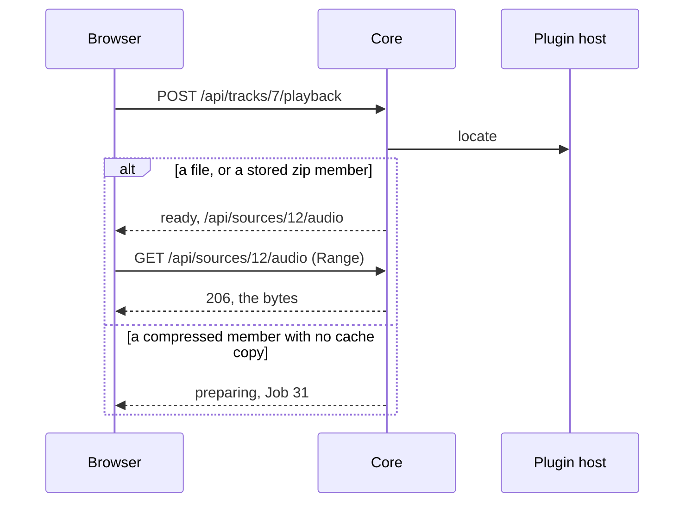

# Playback

> [!NOTE]
> **Status: implemented; the iOS lock-screen check is still to do by hand.** This
> note describes how a browser plays a Track: how the core picks a Source and serves its audio, how a compressed zip member is
> prepared, how plays are recorded, and the bare web client that plays them. What
> playback must do is in [MVP](MVP.md#play); how Libraries locate files is in
> [Libraries](Libraries.md).

## Contents

- [Playing a Track](#playing-a-track)
- [Serving audio](#serving-audio)
- [Preparing a compressed member](#preparing-a-compressed-member)
- [Recording plays](#recording-plays)
- [Availability in the Track list](#availability-in-the-track-list)
- [The web client](#the-web-client)
- [What the API shows](#what-the-api-shows)
- [Testing](#testing)
- [Left for later steps](#left-for-later-steps)

## Playing a Track

- **The client asks to play a Track, and the core picks its Source.** Of the
  Track's Sources that are *ok*, oldest first, the core answers with the first
  that is **ready**; failing that, it starts preparing the first that can be
  prepared and answers **preparing**; failing that, **unplayable**:
  - **ready**, with the Source's audio URL and media type;
  - **preparing**, with the Job that prepares it;
  - **unplayable**, with why: *missing*, *offline*, *unavailable*, or *can't
    play*, taken from the best Source the Track has.
- **The audio URL names a Source by its id;** the server never takes a path from
  the client.
- **A request never waits on a Job.**

## Serving audio

- **Only an *ok* Source is served.** A Source that is *can't play*, *missing*, or
  *unavailable*, or whose Library is offline, answers 404; one that must be
  prepared first answers 409.
- **A location comes from the plugin and is checked by the core.** For a folder
  Library the path must be inside the root; for a zip Library, whose root is the
  archive, it must be the root itself. The core opens the path once, without
  following a link and without blocking on a FIFO, then checks the open file:
  it must be a regular file, and the slice must lie inside it. Every byte is
  read from that open file, so nothing swapped in after the check is served. A
  location that fails the check answers 502, so a faulty plugin can't make the
  core serve a file outside a Library.
- **Locations are remembered per Source,** with the device, inode, size, and
  modification time of the file they point into. An audio request reuses a
  remembered location while the open file still matches, and asks the plugin
  again when it doesn't. Safari sends many Range requests per seek, and the
  plugin host answers one call at a time, so asking on every request would make
  every device wait on every other. `locate` has a 5-second deadline.
- **A file that is gone is an ordinary answer, not a failure:** `locate` replies
  *missing*, also for an archive that is unreadable or being rewritten, instead of
  raising, so an unplugged drive can't fault the plugin. The audio request
  answers 404; only a scan marks the Source *missing*.
- **The core serves the bytes itself,** from an open file, an offset, and a
  length: the whole file for a Library file or a cache copy, a slice of the
  archive for a stored zip member. Starlette's `FileResponse` handles Range only
  for a whole file, so the core has one small response for both:
  - `Range: bytes=a-b`, `a-`, and `-n`; with several ranges, the first one that
    is satisfiable, and 416 with `Content-Range: bytes */n` when none is, as for
    any range of an empty file;
  - a header that doesn't parse, or isn't in bytes, is ignored and the whole slice
    is served, as RFC 9110 says;
  - a strong `ETag`, a hash of the file's device, inode, size, and modification
    time with the offset and length, so it never shows a path. `If-Range` with a
    matching `ETag` serves the range, and anything else serves the whole slice;
    `If-None-Match` with a matching `ETag` answers 304;
  - `HEAD` answers the headers alone;
  - `Accept-Ranges: bytes`, `Cache-Control: private, no-cache`, and
    `X-Content-Type-Options: nosniff`;
  - reads happen off the event loop, a chunk at a time, and stop when the browser
    goes away.
- **The media type comes from the Source's own path,** never from the archive
  holding it, by a table in the core: `audio/mpeg` for `mp3`, `audio/mp4` for
  `m4a`, `m4b`, and `mp4`, `audio/flac`, `audio/ogg` for `ogg`, `oga`, and
  `opus`, `audio/wav`, `audio/aiff` for `aif`, `aifc`, and `aiff`, and
  `audio/x-ms-wma`. Any other extension is `application/octet-stream`.

## Preparing a compressed member

- **A compressed zip member is copied into the cache once,** and that copy is
  served. The copy is `cache/sources/<source id>-<version>.<extension>` in the
  data folder:
  - the version is a hash of the Source's fingerprint, or of the size and
    modification time its scan recorded when it has none, so a rescan that sees
    the file change also changes the name;
  - the extension is one from the media-type table, so a member's name can't
    shape a path.
- **The copy is made by a Job** of the kind `cache_source`, with the target
  `source:<id>:<version>`, so two devices asking at once start one Job, and a
  Job for an older version is never handed back. Its program:
  1. finishes at once when the copy already exists;
  2. fetches the member into the Job's working folder and checks the copy landed
     there and has the member's length;
  3. flushes it to disk and moves it to its cache path with one rename, so a
     half-written copy is never served.
- **Old copies are removed:** a cache Job's completion removes the Source's other
  copies, and the server removes copies of Sources that are gone, or of versions
  that are no longer current, when it starts.
- **The cache counts toward the storage limit,** and the
  [policy](MVP.md#enforce-the-policy) removes cache copies first; until that
  step, copies stay.

## Recording plays

- **A play is recorded with a client-chosen id:** `PUT /api/plays/{id}` with a
  UUID, the Track, and when it was played, which the server clamps to no later
  than now. The id is the Account's own: sending it again changes nothing, and
  sending it with another Track answers 409.
- **Recording a play** adds a row to the `play` table (Account, id, Track, time)
  and, only when the row is new, raises the Account's play count for the Track
  and sets its last played time, in the same transaction.
- **The client decides when a Track counts as played,** as Last.fm counts a
  scrobble: once it has been *playing* for half its length or four minutes,
  whichever is first, so seeking ahead doesn't count. A Track shorter than 30
  seconds never counts. Each start of a Track gets a new id, so a Track played
  twice counts twice.
- **Plays wait in an outbox** in IndexedDB until the server accepts them, so a
  play made while the server is unreachable is recorded later.

## Availability in the Track list

- **Each Track in the list says whether it can play now:** *ok* when one of its
  Sources is *ok* in a Library that is online, otherwise the best of *offline*,
  *unavailable*, *missing*, and *can't play*. The client grays out a Track that
  isn't *ok*, or whose media type its browser can't play.
- **Availability is a hint for the list;** the playback request decides.

## The web client

A bare page: enough to sign in and play music on every device. The full views
come in step 7.

- **Built with what the project already has:** React with `useReducer`,
  `fetch`, and the platform's IndexedDB, with no new dependencies. The page is
  served over plain HTTP on the LAN, which isn't a secure context, so it uses no
  API that needs one: ids come from `crypto.getRandomValues`, not
  `crypto.randomUUID`.
- **The core serves the client:** `npm run build` in `web/` writes it into the
  Python package, in `src/medleyplay/web/client`, which Git ignores and the
  package includes. The server serves it with Starlette's `StaticFiles` at `/`;
  any other path outside `/api` answers the page, and a path under `/api` that
  matches no route answers a JSON 404. The page is served `no-cache` and its
  hashed assets as immutable. Without a built client, `/` says how to build it.
  During development, Vite serves the client and forwards `/api` to the server.
- **Signing in:** the page asks `GET /api/me`; a 401 shows the sign-in form, and
  a server with no Accounts yet shows the first-run form for `POST /api/setup`.
  Any 401 later returns to the sign-in form.
- **The Track list** shows title, artist, album, and duration. Clicking a Track
  plays it and queues the Tracks after it in the list; *Play next* and *Add to
  queue* put a Track in the queue without interrupting.
- **The queue** lists what plays next; a Track can be moved up or down, or
  removed, and the queue cleared. It is a pure reducer, so its rules are unit
  tested apart from the page.
- **The player** shows the Track, play and pause, previous and next, a seek bar,
  and the time.
  - **One persistent `<audio>` element;** the next Track swaps its `src`, so
    autoplay keeps working on iOS after the first tap.
  - **The next Track is asked for ahead of time,** once the current one loads, so
    the `ended` event only swaps `src` and plays: iOS may suspend a locked page
    during a network round trip. Asking ahead also starts preparing a compressed
    next Track.
  - **The queue advances on the `ended` event,** never on a timer.
  - **Previous** restarts the Track after its first three seconds, and goes to
    the previous Track before that.
  - **A Track that is preparing** shows *Preparing*; the client polls its Job,
    every second and then every three, stops at any final state, and asks to play
    again when it succeeds, at most three times. One that fails, is cancelled, or
    can't play shows why, and *Next* skips it.
  - **An audio error** asks `GET /api/me`, so an expired session returns to the
    sign-in form.
- **Media Session:** the Track's metadata; the play, pause, previous, next, and
  seek-to actions, without seek-backward and seek-forward, which iOS would show
  in place of previous and next; `playbackState`; and `setPositionState` when the
  position jumps or the Track loads, only once the duration is known.
- **The queue and the current position are saved in IndexedDB,** best effort. A
  restored position is applied, paused, once the Track's metadata loads; when the
  browser can't save, or has cleared it, the page starts with an empty queue.

## What the API shows

| Route | Who | Does |
| --- | --- | --- |
| `POST /api/tracks/{id}/playback` | Signed in | Picks a Source; answers ready, preparing, or unplayable |
| `GET`, `HEAD /api/sources/{id}/audio` | Signed in | Serves a Source's audio, with Range; 404 when it can't play, 409 when it must be prepared first |
| `PUT /api/plays/{id}` | Signed in | Records a play of a Track under a client UUID |
| `GET /api/tracks` | Signed in | Each Track now also has its `availability` |

## Testing

- **Range:** unit tests and a Hypothesis property: for any slice and any
  satisfiable range, the body is exactly those bytes of the slice. httpx tests
  for `bytes=0-1`, open-ended, suffix, unsatisfiable (416), several ranges,
  malformed headers, `HEAD`, `ETag` with `If-Range` and `If-None-Match`, and the
  media types, including a stored zip member's.
- **Locations:** a fake plugin whose location is outside the Library, past the
  file's end, a link, or not a regular file is refused; a missing file answers
  404; a file changed after it was located is located again.
- **Preparing:** a compressed member prepares through a real Job process, then
  plays from the cache; two requests at once start one Job; a Source with a
  ready Source and a compressed one plays the ready one.
- **Plays:** recording twice counts once; the same id with another Track is
  refused; another Account's ids are its own.
- **Client:** Vitest for the queue reducer, the play-count rule, and the
  components; Playwright against the real server, with a Library of generated
  WAV files, for signing in, playing, seeking, and moving through the queue. A
  test of the built package checks it holds the client.
- **By hand on iOS:** the lock screen, background playback, and moving to the
  next Track while locked.

## Left for later steps

- **Bilibili Downloads** play through the same `playback` request in step 5.
- **The storage limit** and removing cache copies, in step 6.
- **The full views,** artwork, and SSE progress, in step 7.
