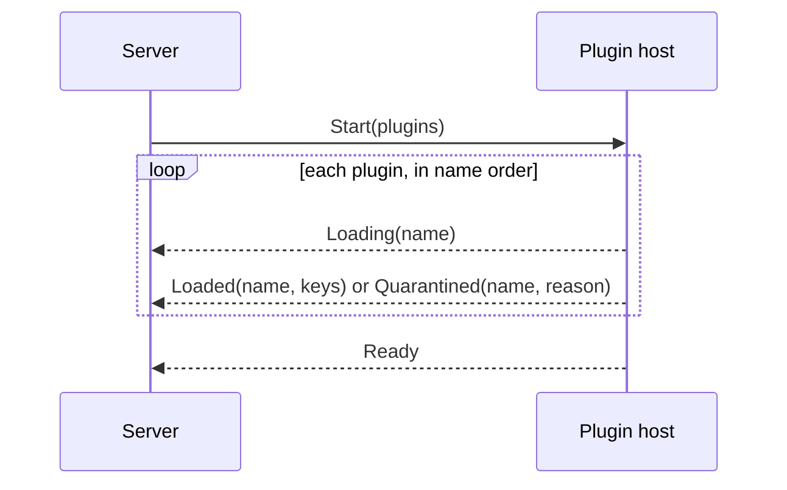

# Plugin host

> [!NOTE]
> **Status: implemented.** This note describes how the core loads plugins, calls
> them in a separate process, and survives their failures. Why the core is split
> this way is in [Architecture](Architecture.md#processes).

## Contents

- [Packages](#packages)
- [The plugin API](#the-plugin-api)
- [The config file](#the-config-file)
- [Plugin states](#plugin-states)
- [Loading plugins](#loading-plugins)
- [Calling a plugin](#calling-a-plugin)
- [Failures and the circuit breaker](#failures-and-the-circuit-breaker)
- [What the API shows](#what-the-api-shows)
- [Testing](#testing)

## Packages

| Package | Holds | May import |
| --- | --- | --- |
| `medleyplay.plugin_api` | What a plugin sees: extension points, operations, the registry, errors, the contract kit | The standard library and Pydantic |
| `medleyplay.plugins.*` | The built-in plugins | `medleyplay.plugin_api` and its own libraries |
| `medleyplay.plugin_host` | Both ends of the pipe: the host process, and the client the server uses | `medleyplay.plugin_api`; a plugin only by name, at run time |
| The rest of the core | The server | Anything below it, never a plugin |

import-linter enforces each row. The plugin host is core code, reviewed like the
server, and the only code that imports a plugin.

## The plugin API

A plugin is a module under `medleyplay.plugins` that defines `plugin`. An
extension point and its operations are declared once, in the plugin API:

```python
class Echo(Protocol):
    def say(self, request: Say) -> Said: ...


ECHO = ExtensionPoint[Echo]("echo")
SAY = ECHO.operation("say", Say, Said, lambda echo: echo.say)
```

A plugin then registers providers for it:

```python
def register(registry: Registry) -> None:
    registry.add(ECHO, "parrot", Parrot())


plugin = Plugin(api_version=1, register=register)
```

- **An extension point**, `ExtensionPoint[P]`, names a `Protocol` `P`. The
  registry's one method, `add(point, key, provider)`, makes mypy check that the
  provider satisfies `P` where the plugin registers it.
- **An operation**, `Operation[P, I, O]`, is one method of `P`: a wire name, a
  Pydantic input model `I`, an output model `O`, a deadline, and an accessor that
  picks the method from a provider. The accessor ties the operation to the
  `Protocol`, so renaming the method or changing its types fails type checking.
- **`api_version`** is the version the plugin was written against, as a literal
  number. A plugin whose version isn't the core's `API_VERSION` is quarantined.
- **A plugin's name** is its module name with hyphens: the module
  `tinytag_tags` is the plugin `tinytag-tags`. The core reads names from the
  package folder without importing anything, so a disabled plugin is never
  imported.
- **A plugin reports** a network problem by raising `NetworkError`, and an
  expired login by raising `AuthError`. Any other exception is a fault in the
  plugin. A plugin that uses the network sets timeouts shorter than its
  operations' deadlines, so a dead network surfaces as `NetworkError` rather than
  a missed deadline.
- **A call carries only its input.** Plugin settings and stored state, which
  Architecture describes, join the call once a plugin needs them.

## The config file

`medleyplay.toml` in the data folder holds the core settings and the plugin
toggles. A missing file means every default. This file turns one plugin off:

```toml
multiple_accounts = false

[plugins.bilibili]
enabled = false
```

- **Every built-in plugin is on** unless the file turns it off.
- **A change applies on restart.**
- **A file that doesn't parse, or a setting with the wrong type, stops the
  server** with a message naming the problem. A plugin name the core doesn't know
  is listed as *unknown* in `GET /api/plugins` and ignored, so a typo shows and
  removing a plugin never stops the server.
- **`medleyplay serve --safe-mode`** turns every plugin off for that run.

## Plugin states

| State | Meaning | Lasts |
| --- | --- | --- |
| *on* | Loaded; its keys answer calls | — |
| *off* | Turned off in the config file or by safe mode; never imported | Until the config changes |
| *quarantined* | Failed to load (see below); never called | Until the server restarts |
| *faulted* | Loaded, but failed too often; never called | Until an admin resets it |
| *unknown* | Named in the config file, but no such plugin exists | Until the config changes |

A key is **available** when the plugin that registered it is *on*.

## Loading plugins



- **The server starts the host as it starts** and waits for `Ready`. Each
  plugin has a load deadline of 30 seconds, long enough for a cold import of a
  large library.
- **A plugin is quarantined** when its import raises, it defines no `plugin`, its
  `api_version` is wrong, its `register` raises, or it claims a key an earlier
  plugin in name order holds. Its registrations are dropped as a whole.
- **A hang or crash on import** is caught by the core: if the host exits, or the
  deadline passes, between `Loading(name)` and that plugin's outcome, the core
  quarantines `name` and starts a new host without it. Each plugin is quarantined
  at most once, so boot waits at most the load deadline once per enabled plugin.
- **A restart loads the same plugins:** every plugin that loaded at boot,
  including faulted ones, so resetting a fault needs no restart. A plugin that
  fails to load on a restart is quarantined then.
- **Standard input and output belong to the protocol.** The host keeps private
  copies of both, then points file descriptor 0 at `/dev/null` and 1 at standard
  error, so a plugin that reads or prints can't corrupt a message. Standard error
  is the server's own, so the host never blocks on it.
- **The host exits when the server goes away.** A thread reads the pipe and ends
  the process when it closes, even while a plugin call is stuck.

## Calling a plugin

```python
said = plugins.call(SAY, "parrot", Say(text="hello"))
```

- **The wire** is one JSON object per line, at most 16 MiB, on the host's standard
  input and output. A request carries an id, the extension point, the key, the
  operation, and its input; a reply carries the same id and the output or a
  failure. Every message is a Pydantic model.
- **One call at a time.** The client sends a call and waits for its reply under
  a lock. A caller waits for the lock no longer than its own operation's
  deadline, then fails as *busy*, so queued requests never pile up behind a hung
  plugin.
- **Deadlines.** A reply that hasn't arrived by the operation's deadline kills
  the host's process group, and the call fails. A host that has died since the
  last call is started again before the call is sent; its death isn't counted
  against the plugin being called. Starting a host has its own load deadlines and
  doesn't use the call's.
- **Memory.** Each reply reports the host's peak memory. Past 1 GiB, the core
  starts a new host before the next call, so a leaking plugin can't grow without
  bound.
- **Both sides validate.** The host validates the input before calling the
  provider, and the output after; the client validates the reply again. Output
  that doesn't validate is a fault in the plugin. Input the host rejects is a
  fault in the core, and doesn't count against the plugin.

## Failures and the circuit breaker

The client raises one of two core errors:

| Error | When | Web status |
| --- | --- | --- |
| `PluginUnavailableError` | The key isn't available, or the host is busy | 503 |
| `PluginCallError` | The call failed; its `kind` is `network`, `auth`, or `plugin` | 502 |

- **Kind `plugin`** covers an unexpected exception, output that doesn't
  validate, a missed deadline, and a host that died during the call. It is the
  only kind that counts toward faulting.
- **A plugin is faulted** when one of its keys fails with kind `plugin` five
  times in a row; a success on that key resets its count. Counting per key means
  a plugin's working keys can't hide a broken one.
- **Faults survive a restart.** They are stored in the `plugin_state` table until
  an admin resets the plugin.

## What the API shows

| Route | Who | Answers |
| --- | --- | --- |
| `GET /api/features` | Signed in | `multiple_accounts`, and the available keys of each extension point |
| `GET /api/plugins` | Admin | Each plugin's state, the reason for it, and its keys |
| `POST /api/plugins/{name}/reset` | Admin | Clears a fault; idempotent |

The client hides a view whose extension point has no available key, such as
*Add from Bilibili* when no plugin resolves Bilibili links.

## Testing

- **Real processes.** The host and the client are tested together through a real
  host process, with test plugins in `tests/support/plugins` and a test extension
  point, *echo*, whose requests ask the provider to sleep, crash, print, raise,
  or return bad output.
- **Load-time faults** each have a test plugin: one whose import raises, one that
  hangs on import, one that crashes on import, one with the wrong `api_version`,
  and one that claims a taken key.
- **The contract kit,** `medleyplay.plugin_api.testing`, checks any operation: its
  output validates, survives a JSON round trip unchanged, and is the same when
  called twice. Each extension point's kit builds on it, and every plugin's tests
  run its points' kits.
